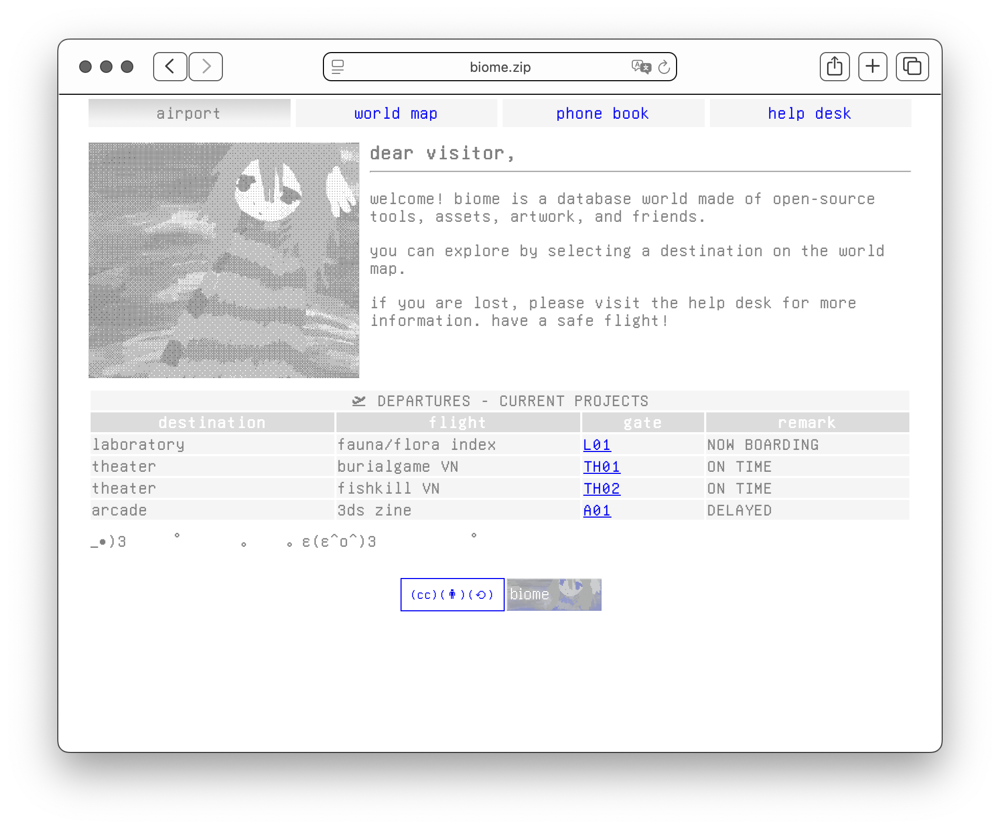
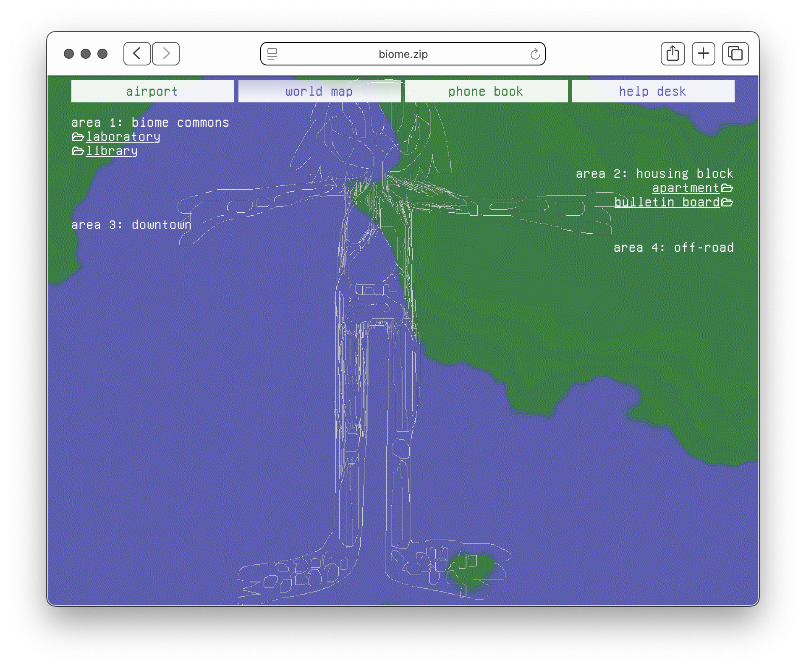
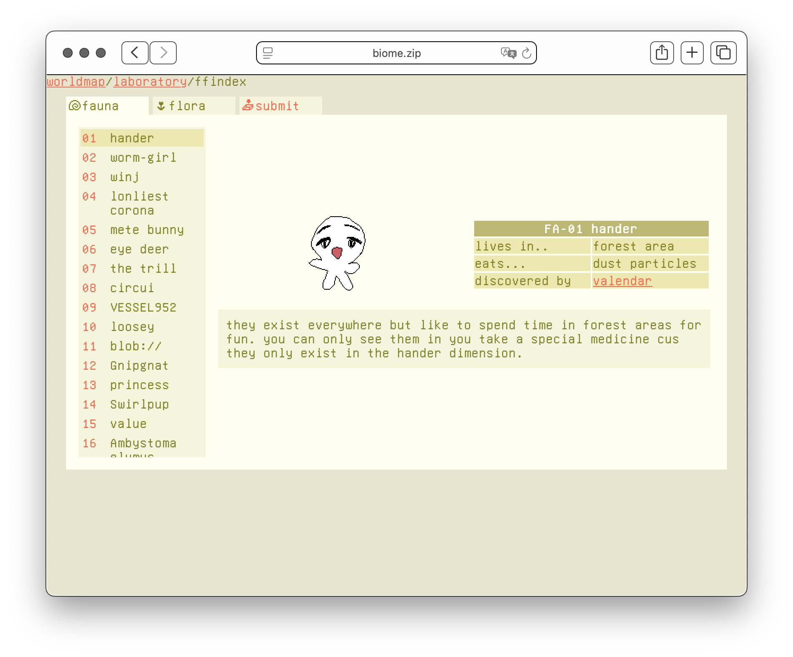
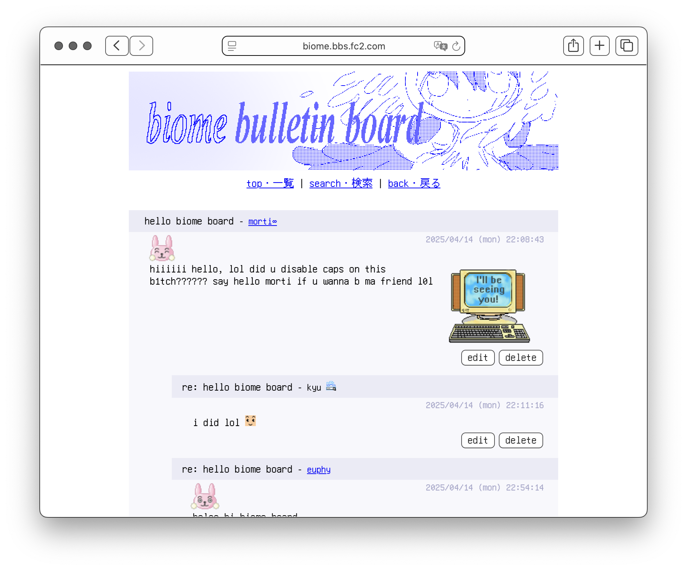

biome is an open-source ecosystem built through exchange. its lore, locations, mechanics, and creatures are shaped by its contributors. users are encouraged to create and remix its resources, and feed them back into biome to populate its world.

<button><a href="https://biome.zip" target="_blank">visit site</a></button>

